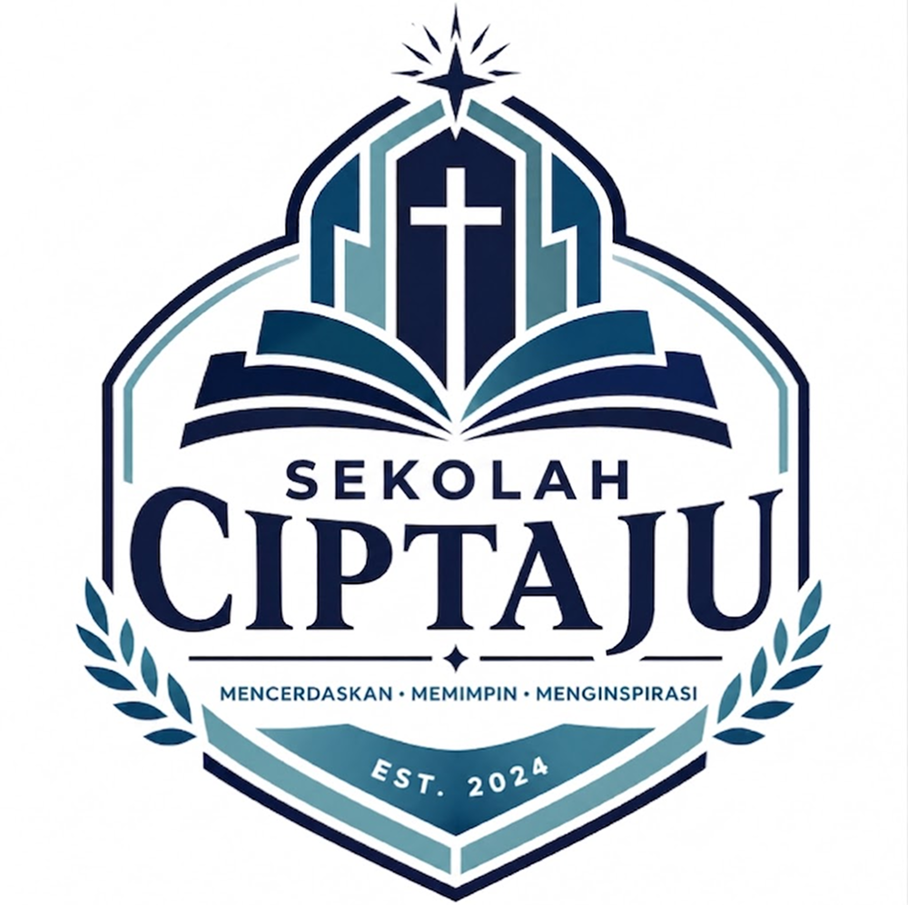

# Ciptaju
<p align="center">
  
</p>
**Ciptaju** is a school registration and information website developed as a school project. The website provides school information, student registration services, and content management features through an administrator dashboard.

The project is built using **Laravel**, **PHP**, **MySQL**, **Laravel Blade**, and **Tailwind CSS**. It follows the Model-View-Controller (MVC) architecture to organize application logic, database interactions, and user interfaces.

---

## Current Project Status

> **Development Status: Full-Stack Web Application**

The current version of Ciptaju includes:

- Responsive website layouts and navigation.
- School information pages.
- News and achievement pages.
- Extracurricular information.
- Vision & Mission page.
- User authentication (Login and Registration).
- Role-based access for Admin and Student.
- Student registration system.
- Admin dashboard.
- User management.
- Student registration management.
- News management (CRUD).
- Achievement management (CRUD).
- Banner management (CRUD).
- Extracurricular management (CRUD).
- Database integration using MySQL.
- Image upload and storage management.
- Form validation and session handling.

---

## Technology Stack

| Technology | Purpose |
|---|---|
| PHP | Backend programming language |
| Laravel 13 | Backend framework |
| MySQL | Relational database |
| Laravel Blade | Server-side templating engine |
| Tailwind CSS | UI styling |
| JavaScript | Frontend interactions |
| Vite | Frontend asset compilation |
| Composer | PHP dependency management |
| Node.js & npm | Frontend dependency management |

---

## Installation & Setup

Before installing the project, make sure the following software is available:

- PHP version compatible with the project dependencies.
- Composer.
- MySQL or MariaDB.
- Node.js and npm.
- Git.
- Laragon (recommended for local Windows development).

### 1. Clone the Repository

```bash
git clone https://github.com/var-sama/ciptaju.git
```

### 2. Navigate into the Project Folder

```bash
cd ciptaju
```

### 3. Install Dependencies

Install PHP dependencies:

```bash
composer install
```

Install frontend dependencies:

```bash
npm install
```

### 4. Configure Environment Variables

Copy the example environment file:

```bash
cp .env.example .env
```

On Windows Command Prompt:

```cmd
copy .env.example .env
```

Generate the application key:

```bash
php artisan key:generate
```

### 5. Configure the Database

Create a new MySQL database named:

```text
ciptaju
```

Configure the database connection inside `.env`:

```env
DB_CONNECTION=mysql
DB_HOST=127.0.0.1
DB_PORT=3306
DB_DATABASE=ciptaju
DB_USERNAME=root
DB_PASSWORD=
```

Adjust the username and password according to your local MySQL configuration.

### 6. Configure the Default Administrator Account

The project uses environment variables to create the initial administrator account through `AdminSeeder`.

Add the following values to your `.env` file:

```env
ADMIN_EMAIL=admin@example.com
ADMIN_PASSWORD=your_secure_password
```

Replace the example email and password with your own credentials.

**Important:** `ADMIN_EMAIL` and `ADMIN_PASSWORD` must be configured before running the database seeders. The administrator account will be created automatically by `AdminSeeder`.

Do not share your `.env` file or commit it to GitHub because it contains private configuration and credentials.

### 7. Run Database Migrations and Seeders

Run:

```bash
php artisan migrate --seed
```

This command performs two operations:

1. **Migrations:** Creates the required database tables.
2. **Seeders:** Populates the database with the initial project data.

The `DatabaseSeeder` automatically calls:

| Seeder | Initial Data |
|---|---|
| `AdminSeeder` | Default administrator account |
| `NewsSeeder` | 17 news records |
| `BannerSeeder` | 3 banner records |
| `AchievementSeeder` | 13 achievement records |
| `ExtracurricularSeeder` | 8 extracurricular records |

The project includes JSON snapshots containing the initial records and their corresponding image files. These files are stored in:

```text
database/seeders/data/
```

The image source files are stored in:

```text
database/seeders/data/images/
```

During seeding, the application copies the required images into Laravel's public storage directory.

**Important:**
- Do not remove the JSON snapshot files or their image directories.
- Make sure these files are included when cloning or downloading the repository.
- The seeders populate the initial sample content; they do not transfer additional records or uploaded files created manually on another computer.
- Running the seeders again updates the bundled sample records using their existing IDs. Configure the administrator credentials before seeding.

### 8. Create the Storage Link

Run:

```bash
php artisan storage:link
```

This creates the public storage link so uploaded and seeded images can be accessed by the website.

### 9. Build Frontend Assets

```bash
npm run build
```

---

## Running the Application

There are two ways to run the application during development.

### Option 1: Using Laravel Development Server

Run:

```bash
php artisan serve
```

The application will be available at:

```text
http://127.0.0.1:8000
```

### Option 2: Using Laragon

1. Open Laragon.
2. Start Apache and MySQL.
3. Make sure the project is located inside the Laragon `www` directory.
4. Access the project through the configured local domain.

For frontend development with Vite, run:

```bash
npm run dev
```

---

## Available Pages & Features

### Public / Student Pages

- Student Landing Page
- School Information
- News
- News Detail
- Achievements
- Achievement Detail
- Extracurricular Information
- Vision & Mission
- About Page
- Student Registration
- User Login and Registration

### Administrator Features

- Admin Dashboard
- User Management
- Student Registration Management
- News Management
- Achievement Management
- Banner Management
- Extracurricular Management

Administrators can manage website content through the dashboard, including creating, viewing, updating, and deleting supported records.

---

## Database Structure

Ciptaju uses MySQL as its relational database.

Database tables are managed through Laravel migrations.

The project includes migrations for:

- Users
- Cache
- Jobs
- News
- Banners
- Achievements
- Extracurriculars
- Student Registrations
- User Roles
- Last Login Information

### Database Seeders

The project provides seeders for the initial application data:

- `AdminSeeder`
- `NewsSeeder`
- `BannerSeeder`
- `AchievementSeeder`
- `ExtracurricularSeeder`
- `DatabaseSeeder`

To run the seeders separately after the migrations have already been executed:

```bash
php artisan db:seed
```

To run a specific seeder:

```bash
php artisan db:seed --class=NewsSeeder
```

The `DatabaseSeeder` automatically executes the configured seeders.

**Note:** The initial data snapshots and image sources are included in the repository. Additional records, user accounts, and uploaded images created after installation are not automatically synchronized between team members.

---

## Project Structure

The main Laravel project structure is organized as follows:

```text
ciptaju/
│
├── app/
│   ├── Http/
│   │   ├── Controllers/
│   │   │   ├── AboutController.php
│   │   │   ├── AchievementController.php
│   │   │   ├── AdminController.php
│   │   │   ├── AuthController.php
│   │   │   ├── BannerController.php
│   │   │   ├── Controller.php
│   │   │   ├── ExtracurricularController.php
│   │   │   ├── NewsController.php
│   │   │   ├── StudentController.php
│   │   │   ├── StudentRegistrationController.php
│   │   │   └── VisionMissionController.php
│   │   └── Requests/
│   │       └── StoreStudentRegistrationRequest.php
│   ├── Models/
│   │   ├── Achievement.php
│   │   ├── Banner.php
│   │   ├── Extracurricular.php
│   │   ├── News.php
│   │   ├── StudentRegistration.php
│   │   └── User.php
│   ├── Providers/
│   │   └── AppServiceProvider.php
│   └── View/
│       └── Components/
│           └── alert.php
│
├── config/
│   └── ciptaju.php
│
├── database/
│   ├── factories/
│   │   ├── NewsFactory.php
│   │   └── UserFactory.php
│   ├── migrations/
│   └── seeders/
│       ├── AchievementSeeder.php
│       ├── AdminSeeder.php
│       ├── BannerSeeder.php
│       ├── DatabaseSeeder.php
│       ├── ExtracurricularSeeder.php
│       ├── NewsSeeder.php
│       ├── Concerns/
│       │   └── SeedsSnapshotRecords.php
│       └── data/
│           ├── achievements.json
│           ├── banners.json
│           ├── extracurriculars.json
│           ├── news.json
│           └── images/
│               ├── achievements/
│               ├── banners/
│               ├── extracurriculars/
│               └── news/
│
├── public/
│   ├── assets/
│   ├── build/
│   ├── storage/
│   └── index.php
│
├── resources/
│   ├── assets/
│   ├── css/
│   │   └── app.css
│   ├── js/
│   │   ├── admin-users.js
│   │   └── app.js
│   └── views/
│       ├── welcome.blade.php
│       ├── about/
│       ├── achievements/
│       ├── admins/
│       │   └── registrations/
│       ├── auth/
│       ├── extracurriculars/
│       ├── layouts/
│       │   └── partials/
│       ├── news/
│       ├── students/
│       └── vision-mission/
│
├── routes/
│   ├── console.php
│   └── web.php
│
├── storage/
│
├── tests/
│
├── .env.example
├── artisan
├── composer.json
├── composer.lock
├── package.json
├── package-lock.json
├── phpunit.xml
├── vite.config.js
└── README.md
```

*Note: The structure above highlights the main application files and directories. Some Laravel framework directories, migration filenames, image filenames, and generated files have been omitted for readability.*

---

## Architecture

Ciptaju follows the **Laravel MVC (Model-View-Controller)** architecture.

- **Models** — Handle database interactions and represent application data.
- **Views** — Use Blade templates to display the website interface.
- **Controllers** — Process requests, handle application logic, and return responses.
- **Migrations** — Define and manage the database structure.
- **Seeders** — Populate the database with initial sample data.
- **Routes** — Define application URLs and connect them to controllers.

---

## File Storage

Uploaded images are managed through Laravel's public storage system.

The application uses the following storage directories:

- `storage/app/public/news`
- `storage/app/public/achievements`
- `storage/app/public/banners`
- `storage/app/public/extracurriculars`

The public storage link connects these files to:

```text
public/storage
```

The initial sample images are bundled in:

```text
database/seeders/data/images/
```

The snapshot seeder copies the required images into the public storage disk during database seeding.

If the storage link does not exist, run:

```bash
php artisan storage:link
```

---

## Contributing

This project was developed as part of a school assignment.

Contributions and suggestions for improving the interface, functionality, and application structure are welcome.

### Contribution Guidelines

1. Keep the code clean and organized.
2. Follow the existing Laravel project structure.
3. Maintain consistency with the current UI design.
4. Test new features before committing changes.
5. Use clear and descriptive Git commit messages.

---

## License

This project is developed for educational purposes as part of a school project.

---

## Team Members

1. Gervasio Velasques
2. Edwin Jonathan
3. Louis Garcia
4. Wilson Christian
